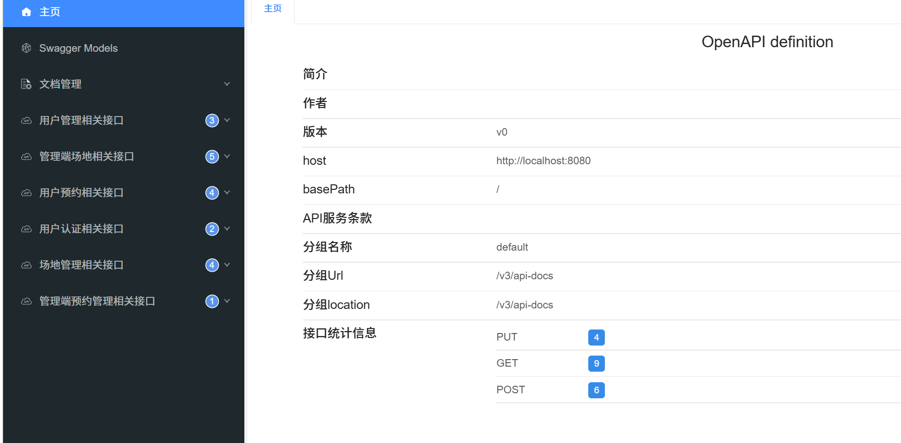

# 校园场地预约系统 (Campus Reservation System)

## 📖 项目简介
这是一个基于 Spring Boot 3 和 Redis 开发的高并发校园场地预约系统。系统支持用户查看场地、时间槽库存、高并发抢座预约、取消预约、查看热门排行榜等功能，同时包含完整的管理端（场地管理、预约流水查询、库存初始化）。

## 🛠️ 技术栈
- **核心框架**：Spring Boot 3.2.x、JDK 17
- **持久层**：MyBatis-Plus 3.5.x、MySQL 8.0
- **缓存与并发**：Redis (String, ZSet, Lua脚本)、Redisson (分布式锁、延迟队列)
- **消息队列**：Redis Stream (消费者组、Pending List 死信重试)
- **安全鉴权**：JWT (JSON Web Token)、Spring MVC 拦截器
- **接口文档**：Knife4j (OpenAPI 3)

## ✨ 核心功能与技术亮点
1. **高并发防超卖**：基于 Redis + Lua 脚本实现库存预扣，保证原子性；结合 Redis Stream 异步落库，削峰填谷。
2. **订单超时自动取消**：基于 Redisson 延迟队列 (DelayedQueue) 实现订单 15 分钟未支付自动取消，并回滚库存。
3. **缓存与一致性**：采用 Cache Aside 模式处理场地详情与库存查询；空值缓存防穿透，随机 TTL 防雪崩。
4. **定时任务与分布式锁**：利用 Redisson 保证多节点环境下库存预热任务不重复执行。
5. **复杂业务查询**：管理端预约流水采用 MyBatis XML 动态 SQL 连表查询，解决 N+1 问题。

## 📂 项目结构
```text
com.campus.reservation
├── common        # 公共模块 (统一返回 Result、全局异常、JWT工具、UserContext)
├── config        # 配置类 (Redis, Redisson, MyBatisPlus, RabbitMQ/Stream, Knife4j)
├── controller    # 控制层 (分为 user 和 admin 两个包)
├── dto           # 数据传输对象 (接收前端参数)
├── entity        # 数据库实体类
├── interceptor   # 拦截器
├── mapper        # MyBatis-Plus Mapper 接口
├── mq            # 消息队列消费者 (Stream消费者、延迟队列消费者)
├── service       # 业务逻辑层
├── task          # 定时任务 (库存预热)
└── vo            # 视图对象 (返回给前端的脱敏数据)

## 🚀 快速启动

1. 环境准备：确保本地已安装 JDK 17、Maven、MySQL 8.0 和 Redis。
2. 初始化数据库：在 MySQL 中创建数据库 campus_reservation，执行你自己的建表语句。
3. 修改配置：复制 src/main/resources/application-dev-example.yml 并重命名为 application-dev.yml，填入你本地的 MySQL 和 Redis 连接密码。
4. 启动项目：运行 ComCampusReservationApplication.java 主类。
5. 访问文档：项目启动成功后，访问 Knife4j 接口文档：[http://localhost:8080/doc.html](http://localhost:8080/doc.html)

## 📝 接口说明

本项目提供完整的 RESTful API，分为 用户端 和 管理端，核心接口包含：

### 用户端
- POST /api/auth/login：用户登录获取 JWT Token
- GET /api/venues：分页查询场地列表（带缓存）
- GET /api/venues/{id}/slots：查询某天场地的时间槽库存
- POST /api/reservations：高并发创建预约（Redis + Lua 预扣库存，Redis Stream 异步落库）
- POST /api/reservations/{id}/cancel：取消预约并回滚库存

### 管理端
- POST /api/admin/venues：新增场地
- POST /api/admin/stocks/init：初始化某天场地库存
- GET /api/admin/reservations：多表连查预约流水（解决 N+1 问题）

---

(👇 接口文档预览)
()

👉 更多接口详情请启动项目后访问 Knife4j 在线文档查阅。
